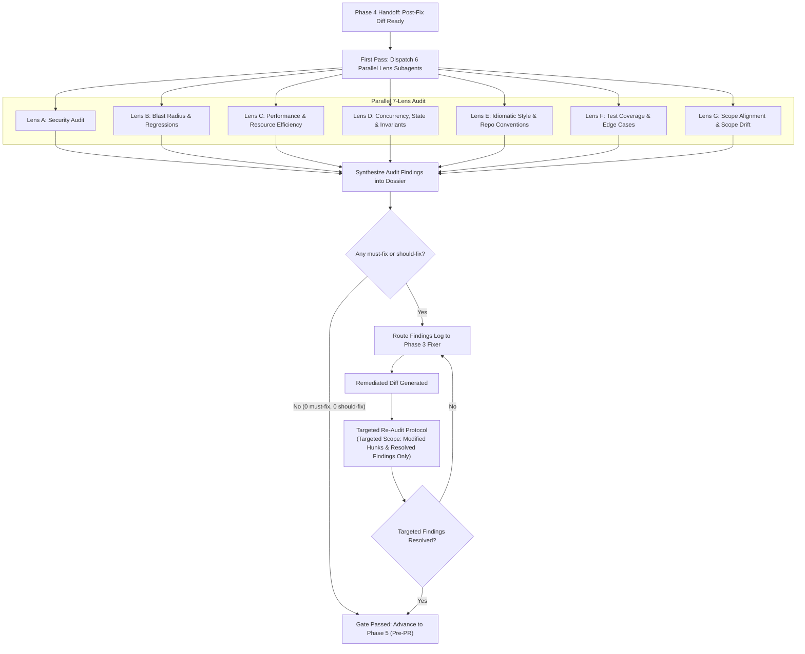

# Orchestrator Skill — Open Post-Fix Multi-Lens Audit

## 1. Post-Fix Audit Principles

Post-fix audit is an adversarial quality gate. The auditor's objective is not to validate that code looks plausible or to rubber-stamp the implementation; the auditor's mandate is to actively search for failure modes, security vulnerabilities, regression risks, and subtle behavioral drift before any code reaches a pull request.

### 1.1 Zero-Forgiveness Standard
- **No Compromises on Correctness or Security**: Code changes must be 10/10 strict. "Probably fine," "low likelihood in practice," or "acceptable for now" are treated as rejected submissions.
- **Blunt Engineering Rigor**: Reviewers operate with zero persona and senior-to-senior engineering precision. Every assertion must be substantiated with verifiable evidence (AST analysis, line numbers, command execution output, or deterministic test traces).
- **Scope Lock Integrity**: Code modifications must adhere strictly to the pre-authorized scope (`authorized_scope`). Any unrequested refactor, unsolicited renaming, drive-by formatting alteration, or extraneous dependency addition constitutes an immediate audit failure.
- **Out-of-Scope Diff = Automatic must-fix**: Every line of the eventual diff must trace to a verbatim Scope Contract line from the issue dossier. Any line that cannot trace is `must-fix` and MUST be removed before the PR advances. This applies to: new public options/fields/methods, new exports, refactors, formatting sweeps, opportunistic cleanups, dependency bumps, or unrelated test additions.
- **Core Schema Change Detection**: Modifications to DB schema, migration files, exported type definitions, public serialization shapes, or stable API contracts are high-blast-radius. Any such change without explicit Scope Contract or maintainer authorization = `must-fix` to revert.
- **Maintainer Taste Gate**: OSS maintainers prefer short, minimal, on-point, surgical diffs. A diff that is technically correct but verbose, speculative, or inventively broad is `should-fix` — tighten it before promoting to Phase 5.
- **Scope Drift = Blocking Defect (same severity as security)**: Scope drift is treated with the same gravity as a security vulnerability, a functional regression, or a public-contract break. A single out-of-scope line in a diff is enough to FAIL the audit gate. There is no "minor scope drift" — every untraced line is `must-fix` for removal.
- **Bulletproof Zero-Loophole Bar**: Even minor edge, minor drift, or minor convention miss = FAIL. Upstream standard: strict, clean, minimal, professional. If it would not pass upstream maintainers, REJECT.
- **Mandatory Parallelism**: Phase 4 initial + re-audit both require multiple parallel reviewers (initial 7, re-audit min 3). Parallel use has zero cost concern — thoroughness over speed. Single reviewer never passes gate.


### Changeset Audit(this applies only when there is any changeset file involved which maximum times will when working on better-auth repo)

For the only subagent checking `.changeset/*.md` if any exist, skip if there is no changeset file:
- **Length**: Flag any changeset body exceeding 5 lines or bullet points.
- **Content**: Must describe solely what the change does. Flag any issue references, background stories, or negative scoping statements as must-fix.
- **Accuracy**: Confirm every cited HTTP method, route, and API name matches the code diff exactly.


### 1.2 Severity Classification & Tagging Standard
Every issue surfaced during an audit must be tagged with one of three explicit severities:

| Severity | Definition | Action Required |
|---|---|---|
| `must-fix` | Critical defects: security vulnerabilities, functional regressions, broken public contracts, unhandled exceptions/panics, data corruption, race conditions, memory leaks, failing/flaky tests, **or scope drift (any untraced diff line, unauthorized public surface, unauthorized core schema change, opportunistic cleanup, refactor, formatting sweep, or "while-I'm-here" edit)**. | **Hard Block**: Blocks the audit gate unconditionally. The orchestrator must reject the patch and route findings back to Phase 3. |
| `should-fix` | Architecture/quality defects: subtle boundary omissions, missing assertions in tests, anti-patterns, style violations contradicting repository conventions, unoptimized resource paths, or duplicated logic. | **Hard Block**: Blocks the audit gate unconditionally. Must be remediated or explicitly justified before promotion to Phase 5. |
| `nitpick` | Non-blocking observations: minor grammatical typo in a comment, subjective naming suggestion where existing name meets project conventions, or trivial stylistic preference. | **Non-blocking**: Logged in the audit summary for optional cleanup. Does not block promotion to Phase 5 unless accompanied by higher severities. |

### 1.3 Clean Gate Requirement
The Phase 4 Audit Gate enforces an absolute binary threshold:
$$\text{Gate Outcome} = \begin{cases} \mathbf{PASS} & \text{if } \text{count}(\texttt{must-fix}) = 0 \land \text{count}(\texttt{should-fix}) = 0 \\ \mathbf{FAIL} & \text{if } \text{count}(\texttt{must-fix}) > 0 \lor \text{count}(\texttt{should-fix}) > 0 \end{cases}$$

No pull request may be drafted or updated while any `must-fix` or `should-fix` item remains open.

---

## 2. Phase 4 Execution Workflow

The audit workflow is orchestrated in two distinct modes: the **Initial Full Audit (First Pass)**, which executes a comprehensive multi-perspective review across 6 parallel lenses, and the **Re-Audit Protocol**, which enforces localized, targeted verification on remediated diffs.



---

### 2.1 First Pass: Initial Full Audit (7 Parallel Subagents)

The orchestrator spawns **exactly 7 parallel subagents**, dedicating each subagent to an independent analytical lens. Every subagent receives the complete diff, the issue dossier, the authorized scope, and repository conventions.

#### Lens A: Security Audit
- **Objective**: Identify all security vulnerabilities, trust boundary violations, and credential handling hazards introduced or exposed by the patch.
- **Scope of Inspection**:
  - Full execution of Section 3 (§3.1 Universal OSS Vulnerabilities and §3.2 Auth/Crypto/Access-Control).
  - Sanitization of untrusted input at ingestion boundaries.
  - Evaluation of third-party dependency updates or calls for supply-chain or execution risks.
  - Identification of sensitive data leakage into logs, exceptions, or client responses.
- **Output**: Detailed findings report referencing specific lines and CWE identifiers, categorized by severity (`must-fix` / `should-fix` / `nitpick`).

#### Lens B: Blast Radius & Regressions
- **Objective**: Ensure the change does not break downstream consumers, alter public API contracts unexpectedly, or cause silent behavioral regressions.
- **Scope of Inspection**:
  - Direct and transitive caller analysis: verify that all call-sites are compatible with altered argument types, return types, or thrown exception shapes.
  - Public export surfaces: check index and barrel files (`index.ts`, `__init__.py`, exported Go/Rust symbols) to ensure no breaking changes to public APIs unless explicitly authorized.
  - Default behavior preservation: verify that existing defaults remain intact for existing callers.
  - Configuration and schema compatibility: ensure environment variables, configuration parameters, and serialization schemas maintain backward compatibility.
- **Output**: Blast radius map with verified call-site citations and regression risk assessment.

> **Note:** Scope-alignment logic (line-level trace, public-surface invention detection, core-schema lock) is **owned by Lens G (Scope Alignment)** below, NOT by Lens B. Lens G is the dedicated first-class citizen for scope discipline.

#### Lens C: Performance & Resource Efficiency
- **Objective**: Prevent computational regressions, algorithmic blowups, memory leaks, and I/O bottlenecks.
- **Scope of Inspection**:
  - Algorithmic complexity: scan for accidental $O(N^2)$ loops, nested iterations over unbounded collections, or redundant traversals.
  - Memory management & allocations: detect excessive object allocations inside hot loops, unnecessary buffer copies, missing stream consumption, or large payloads buffered into memory.
  - Resource lifecycle leaks: verify that file handles, database connections, child processes, web sockets, and event listeners are deterministically closed/released in `finally` / `defer` blocks.
  - I/O efficiency: flag synchronous I/O operations on event loops or async worker threads, N+1 query patterns, and unbatched network requests.
- **Output**: Performance profile analysis with identified hot paths and resource cleanup audits.

#### Lens D: Concurrency, State & Invariants
- **Objective**: Validate thread safety, asynchronous correctness, state machine transitions, and invariant preservation.
- **Scope of Inspection**:
  - Concurrency hazards: identify race conditions, Deadlocks, Time-of-Check to Time-of-Use (TOCTOU) windows, and shared mutable state accessed without proper synchronization (mutexes, atomics, channels).
  - Asynchronous workflows: audit Promise/async handling—ban unhandled promise rejections, floating unawaited promises, improper error propagation, and missing cancellation signal/context propagation (`AbortController`, `context.Context`).
  - State machine invariants: ensure that all valid state transitions are complete, invalid transitions fail fast with explicit errors, and partial mutations are safely rolled back upon failure.
  - Re-entrancy and idempotency: evaluate whether operations intended to be idempotent are resilient to duplicate execution or concurrent invocations.
- **Output**: State transition verification and concurrency safety analysis.

#### Lens E: Idiomatic Style & Repo Conventions
- **Objective**: Enforce the "surgical, blends-in" standard. Code must read as if written by the primary author of the surrounding module.
- **Scope of Inspection**:
  - Repository stylistic coherence: match naming patterns, indentation, comment tone, and structural layout of neighboring code.
  - Idiomatic language usage: use standard constructs native to the language version specified by the repo (e.g., modern pattern matching, standard error unwrapping).
  - Reuse of existing abstractions: ensure the diff reuses existing helper functions, utility classes, and validation modules discovered in Phase 2 rather than introducing duplicate implementations.
  - Zero debug artifacts: verify that no temporary logging (`console.log`, `print`, `fmt.Println`), commented-out legacy code, temporary hacks, or agent TODO markers remain in the diff.
- **Output**: Style and convention compliance audit with citations to existing utilities.

#### Lens F: Test Coverage & Edge Cases
- **Objective**: Ensure comprehensive, deterministic, and adversarial test coverage for all modified branches and edge cases.
- **Scope of Inspection**:
  - Boundary and edge-case coverage: test zero/empty inputs, null/nil/undefined values, extreme bounds (integer limits, max payload sizes), special characters, and Unicode inputs.
  - Negative path verification: confirm that failure paths, invalid inputs, network drops, and operational errors trigger expected exceptions/error returns.
  - Anti-gaming and test validity:
    - Verify that new tests genuinely fail against the unpatched codebase (confirming reproduction fidelity).
    - Ensure tests do not pass vacuously due to over-mocking, tautological assertions (`expect(true).toBe(true)`), or swallowing exceptions.
    - Confirm existing tests have not been weakened, commented out, or loosened in assertion thresholds.
  - Test isolation and determinism: ensure tests do not depend on external network access, specific clock times, execution order, or shared global state.
- **Output**: Test suite audit with explicit coverage metrics for modified code paths and edge cases.

#### Lens G: Scope Alignment & Scope Drift (DEDICATED — FIRST-CLASS CITIZEN)

> **Why dedicated**: OSS maintainers strictly prefer short, minimal, on-point, 101% scope-aligned PRs. Scope drift is the #1 maintainer-rejection trigger. This lens exists to ensure that no other lens' work accidentally lets an out-of-scope line slip through. **Scope drift is treated with the same severity as a security vulnerability** (see §1.1 Scope Drift = Blocking Defect).

- **Objective**: Verify that every line of the eventual diff is strictly aligned with the harvested Scope Contract from the issue dossier (`issue-context/<issue-id>.md`). Detect, classify, and flag every form of scope drift as `must-fix`.
- **Scope of Inspection**:
  - **Line-Level Scope Trace**: For every line of the diff, verify it traces to a verbatim line in the harvested Scope Contract (issue dossier `issue-context/<issue-id>.md`). Untraced lines = `must-fix` for removal. This is line-level, not file-level — a line inside an in-scope file that is itself out of scope is still out of scope.
  - **Public Surface Invention**: Detect any newly added public option, field, method, capability override, exported type, or configuration knob that the issue did not request. Each = `must-fix` to revert. Disguising a `feat` as a `fix` because the issue is filed as a bug is a violation — re-classify honestly.
  - **Core Schema Lock**: Detect any modification to DB schema, migration files, exported type definitions, public serialization shapes, or stable API contracts. Each = `must-fix` to revert unless explicitly authorized by the Scope Contract or a direct maintainer comment in the issue thread.
  - **Adjacent Refactor / Drive-By Cleanup**: Cross-reference adjacent hunks for unrequested refactors, opportunistic cleanups, formatting sweeps, dependency bumps, unrelated test additions, or "while-I'm-here" edits. Each = `must-fix` to revert.
  - **Maintainer Taste Gate**: If a diff is technically correct but verbose, speculative, or inventively broad, flag as `should-fix` — tighten it before promoting to Phase 5.
  - **Scope Discipline Confirmation**: Cross-check the fixer's dispatch-prompt "Scope Discipline Confirmation" checklist (defined in `open-pre-fix/skills.md` §4) against the actual diff. Missing affirmation = FAIL.
- **Output**: Scope alignment report with:
  - Traced-vs-untraced diff line count (e.g. `47 traced / 3 untraced`)
  - Public surface delta (added/removed/modified public symbols, each with Scope Contract citation or `UNAUTHORIZED` flag)
  - Core schema delta (schema changes, each with authorization citation or `UNAUTHORIZED` flag)
  - Adjacent refactor / drive-by cleanup list
  - Maintainer taste verdict (`tight & surgical` / `verbose but correct` / `speculative & broad`)
- **Severity rule**: Every finding from this lens is `must-fix` by default — there is no "minor scope drift" category. A single untraced line is enough to FAIL the audit gate.

---

### 2.2 Re-Audit Protocol (CRITICAL RULE)

When findings (`must-fix` or `should-fix`) are surfaced during an audit:
1. The orchestrator compiles all findings into the structured `review_findings_log` and dispatches them back to Phase 3 fixers.
2. The fixer generates a targeted patch addressing the cited defects.

> [!IMPORTANT]
> **Subsequent re-audits do NOT re-run all 6 lenses!**
> Once the initial 6-lens pass is complete, running a full 6-lens pass on every revision creates compounding latency, consumes unnecessary tokens, and introduces distraction from hallucinated findings on untouched code.
> **Subsequent review passes are small, focused, targeted audits restricted strictly to:**
> - The specific files and hunks modified in the remediation patch.
> - Verifying that every flagged item in `review_findings_log` has been resolved cleanly.
> - Checking for localized regressions or side effects introduced directly by the remediation diff.
> - **Re-running scope-alignment verification on the remediation patch** — confirm the fixer did not re-introduce scope drift while addressing previous findings (one of the 3+ reviewers in re-audit MUST be a scope-alignment reviewer).

#### Re-Audit Execution Steps:
1. **Scope Definition**: Identify the exact files and lines touched by the remediation patch.
2. **Targeted Subagent Dispatch**: Spawn 1–3 focused reviewer subagents (min 3) assigned specifically to:
   - Verify the precise resolution of previous `must-fix` and `should-fix` items.
   - Audit the new delta for syntax, regression, and security issues within the touched hunks only.
   - **Re-run scope-alignment verification on the remediation patch** (at least one reviewer must own this).
3. **Regression Check**: Re-run the automated test suite and lint/type checks across the workspace.
4. **Log Update**: Update `review_findings_log` marking resolved items as `RESOLVED` with the commit/patch reference, or `UNRESOLVED` if the remediation was incomplete.

---

## 3. Comprehensive Security Checklist

This checklist is mandatory. Every audit must explicitly verify all applicable items across §3.1 and §3.2.

### 3.1 Universal OSS Vulnerability Checks

- [ ] **Command Injection (CWE-78)**:
  - Enforce safe execution APIs (`child_process.execFile`, `child_process.spawn`, Python `subprocess.run(..., shell=False)`, Go `exec.Command`) passing arguments as discrete array elements rather than raw string concatenation into a shell command line.
  - Strictly prohibit shell invocation flags (`shell: true`, `/bin/sh -c`, `cmd.exe /c`).
  - If shell execution is unavoidable due to explicit requirements, enforce an immutable allow-list for command names, apply platform-specific argument escaping (distinguishing between POSIX and Windows shell parsing rules), and reject shell metacharacters (`|`, `&`, `;`, `$`, `>`, `<`, `` ` ``, `\n`).

- [ ] **Path Traversal & Arbitrary File Access (CWE-22, CWE-23, CWE-59)**:
  - Canonicalize and resolve all paths using native safe primitives (`path.resolve`, `os.path.realpath`, `filepath.Clean`) before validation.
  - Explicitly verify that the resolved absolute path resides strictly within the intended root base directory (e.g., `resolvedPath.startsWith(baseDir + path.sep)` or directory boundary checks).
  - Block directory traversal sequences: reject or sanitize `../`, `..\`, null bytes (`%00`), and URL/double-encoded traversal sequences (`%2e%2e%2f`).
  - Guard against symlink redirection and Time-of-Check to Time-of-Use (TOCTOU) file race conditions where an untrusted symlink points outside the intended root boundary.

- [ ] **SSRF (Server-Side Request Forgery) (CWE-918)**:
  - Validate and restrict all destination URLs on outgoing HTTP/fetch/socket requests when the host, IP, port, or path is influenced by caller/user input.
  - Enforce an explicit allow-list of schemes (`https://` only) and allowed hostnames/domains.
  - Block internal, private, loopback, link-local, and cloud metadata IP ranges (`127.0.0.0/8`, `10.0.0.0/8`, `172.16.0.0/12`, `192.168.0.0/16`, `169.254.169.254`, `::1`, `fc00::/7`, `fe80::/10`).
  - Guard against DNS rebinding and redirect bypasses by resolving DNS before verification, pinning the connection socket IP, and re-validating redirect target URLs against the same policy.

- [ ] **ReDoS (Regular Expression Denial of Service) (CWE-1333)**:
  - Audit all regular expressions against catastrophic backtracking, particularly those matching untrusted, caller-supplied input.
  - Prohibit unbounded nested quantifiers (e.g., `(a+)+`, `([a-zA-Z]+)*`, `(a|b|ab)*`), overlapping alternations within repetitions, and unbounded wildcards preceding repetitive delimiters.
  - Enforce maximum input length limits before evaluating regular expressions on untrusted input, or use linear-time regex engines / deterministic parsers.

- [ ] **Prototype Pollution & Unsafe Deserialization (CWE-1321, CWE-502)**:
  - Guard recursive object merges, deep clones, and dynamic property assignment against key injection: explicitly reject or strip `__proto__`, `constructor`, and `prototype`.
  - Use safe dictionary containers (e.g., `Object.create(null)` or `Map`) when storing arbitrary caller-controlled keys.
  - Ban unsafe deserialization primitives (`eval()`, `new Function()`, Python `pickle.loads()`, `yaml.unsafe_load()`, unvetted binary/object deserializers). Use safe, schema-validated serialization parsers (`JSON.parse` with reviver validation, strict schema decoders).

- [ ] **Memory, Allocation & Type Bounds Checks (CWE-119, CWE-120, CWE-190, CWE-400)**:
  - Enforce strict allocation and buffer limits: prevent unbounded buffer allocations, huge memory reservations, or decompression bombs (zip bomb, gzip bomb, XML entity expansion) derived from untrusted size headers or counts.
  - Safe array and slice indexing: validate offsets, limits, and lengths before slicing/indexing to prevent out-of-bounds access or negative index misinterpretations.
  - Guard against integer overflow / underflow or truncation in systems languages; in dynamically-typed languages, enforce safe type coercion and reject unexpected composite types (e.g., object passed where string/number expected leading to logic bypass or unhandled crashes).

---

### 3.2 Authentication, Cryptography & Access Control Checks

- [ ] **Constant-Time Comparison (CWE-208)**:
  - Enforce non-short-circuiting constant-time comparisons for every secret, token, signature, API key, password hash, and MAC verification (e.g., Node's `crypto.timingSafeEqual`, Python's `hmac.compare_digest`). Standard string equality (`===`, `==`) leaks secrets via byte-by-byte timing discrepancy.
  - Eliminate differential timing across multiple valid keys or tokens—verifying against candidate sets must not early-exit in a manner that reveals which candidate matched or how many bytes were valid.

- [ ] **Cryptographic Randomness (CSPRNG) (CWE-338)**:
  - Generate all session identifiers, security tokens, nonces, salts, and initialization vectors using a cryptographically secure pseudorandom number generator (CSPRNG) with $\ge 64$ bits of entropy.
  - Ban non-cryptographic pseudo-random sources (`Math.random()`, `rand()`, `Date.now()`, PID) for security-sensitive values.

- [ ] **Session Management & Session Fixation (CWE-384)**:
  - Regenerate session identifiers upon user authentication, login, privilege escalation, or role changes.
  - Terminate and invalidate sessions server-side upon logout, absolute maximum session lifetime expiry, or prolonged inactivity timeout.

- [ ] **Cookie Security Flags (CWE-614, CWE-1004)**:
  - Cookies carrying authentication tokens or session IDs must enforce `HttpOnly` (preventing XSS theft), `Secure` (restricting transmission to HTTPS), and appropriate `SameSite` policies (`Strict` or `Lax`).
  - Scope cookie `Domain` and `Path` strictly to prevent leaking credentials across subdomains or untrusted paths.

- [ ] **Insecure Direct Object Reference (IDOR) & Access Control (CWE-639, CWE-285)**:
  - Every endpoint or function mutating or retrieving data must execute a centralized authorization check verifying that the authenticated identity possesses explicit ownership or permission for the requested resource ID.
  - Never rely solely on user authentication ("is user logged in"); require resource-level authorization ("does user own resource X").
  - Re-verify authorization server-side on every request for sensitive operations; do not trust client-supplied privilege claims or stale session caches.

- [ ] **Input Validation & DoS Defenses (CWE-20, CWE-400)**:
  - Validate and sanitize input structure, length, format, and types at the network edge before initiating expensive parsing, decoding, or database operations.
  - Ensure malformed or oversized payloads are rejected early with structured errors, never causing uncaught panics or unhandled exceptions that degrade service availability.

- [ ] **Credential Storage & Secret Management (CWE-798, CWE-256, CWE-916)**:
  - Zero hardcoded secrets: audit all diffs to confirm no API keys, private certificates, database connection strings, or bearer tokens are committed to source files.
  - Password hashing must utilize modern adaptive memory-hard or work-factored algorithms (Argon2id, bcrypt with cost $\ge 12$, or scrypt). Prohibit MD5, SHA-1, raw SHA-256/512, DES, or RC4.

- [ ] **JWT (JSON Web Token) Security (CWE-345, CWE-347)**:
  - Explicitly restrict acceptable signature algorithms via an allow-list (e.g., `algorithms: ['RS256']`); explicitly reject the `none` algorithm.
  - Enforce full cryptographic signature verification (`jwt.verify()`) rather than unverified payload decoding (`jwt.decode()`) before acting on any claim.
  - Strictly validate standard token claims: expiration (`exp`), not-before (`nbf`), issued-at (`iat`), issuer (`iss`), and audience (`aud`).

- [ ] **Audit Logging of Security Events (CWE-778)**:
  - Log all security-critical operations (login successes, login failures, privilege escalations, password changes, authorization rejections).
  - Ensure audit logs sanitize sensitive data: never log plaintext passwords, session tokens, full credit card numbers, or personally identifiable information (PII).

---

## 4. Audit Gate Evaluation & Reporting

### 4.1 Gate Evaluation Checklist
Before the orchestrator authorizes a transition from Phase 4 to Phase 5 (Pre-PR), every item below must be satisfied with concrete evidence:

- [ ] **0 Must-Fix Findings**: All critical and blocking defects across all lenses are completely resolved.
- [ ] **0 Should-Fix Findings**: All quality, conventions, performance, and boundary defects are resolved or documented with maintainer-approved justifications.
- [ ] **Reproduction Verification**: The original failing reproduction test constructed in Phase 1 executes against the final diff and passes deterministically.
- [ ] **Full Test Suite Clean**: 100% of the repository's automated test suite passes with zero regressions or skipped tests.
- [ ] **Static Analysis & Tooling**: Repository linters, type-checkers, and formatters execute cleanly without warnings or errors introduced by the diff.
- [ ] **Scope Enforcement (line-level)**: Every line of the diff traces to a verbatim Scope Contract line from the issue dossier (`issue-context/<issue-id>.md`). The diff touches only files explicitly enumerated in `authorized_scope` AND every line within those files is in-scope. Out-of-scope lines, unauthorized public surface additions, and unauthorized core schema changes are all resolved.
- [ ] **Clean Git Tree**: No temporary files, debug logging statements, commented-out dead code, or unintended modifications exist in the working directory.

### 4.2 Audit Report Template

Every completed Phase 4 audit must generate a structured report recorded in the conversation dossier:

```markdown
### Phase 4 Audit Report

**Diff Summary**: <Files changed, insertion/deletion line counts>
**Target Scope**: <Authorized scope allow-list>
**Audit Mode**: <First Pass (Full 6-Lens) | Re-Audit (Targeted Delta)>

#### Lens Evaluation Matrix
| Lens | Subagent | Status | Findings Summary |
|---|---|---|---|
| Lens A: Security | Subagent A | PASS / FAIL | <Summary of checks run and result> |
| Lens B: Blast Radius & Regressions | Subagent B | PASS / FAIL | <Call-sites verified, compatibility confirmed> |
| Lens C: Performance & Resources | Subagent C | PASS / FAIL | <Complexity, allocations, leaks audited> |
| Lens D: Concurrency & Invariants | Subagent D | PASS / FAIL | <Race conditions, state transitions audited> |
| Lens E: Idiomatic Style & Repo Conventions | Subagent E | PASS / FAIL | <Surgical fit, conventions verified> |
| Lens F: Test Coverage & Edge Cases | Subagent F | PASS / FAIL | <Edge cases, negative paths, determinism verified> |
| Lens G: Scope Alignment & Scope Drift | Subagent G | PASS / FAIL | <Traced/untraced line count, public surface delta, core schema delta, adjacent refactor list, maintainer taste verdict> |

#### Findings Log
| ID | Lens | Severity | File:Line | Description | Resolution Status |
|---|---|---|---|---|---|
| F-01 | Lens A | must-fix | src/api.ts:42 | Missing constant-time comparison on token | RESOLVED (Patch #2) |
| F-02 | Lens E | nitpick | src/utils.ts:15 | Prefer internal helper over inline logic | RESOLVED (Patch #2) |

#### Final Gate Assessment
- **Must-Fix Count**: 0
- **Should-Fix Count**: 0
- **Gate Status**: APPROVED (Ready for Phase 5 Pre-PR)
```
